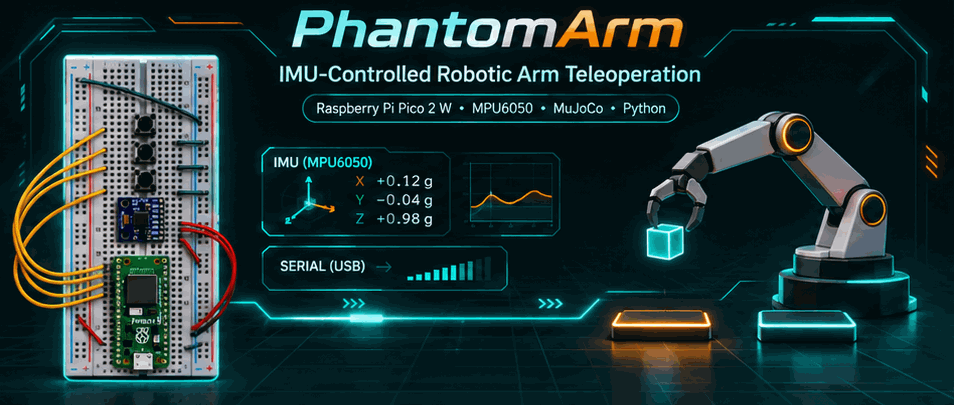
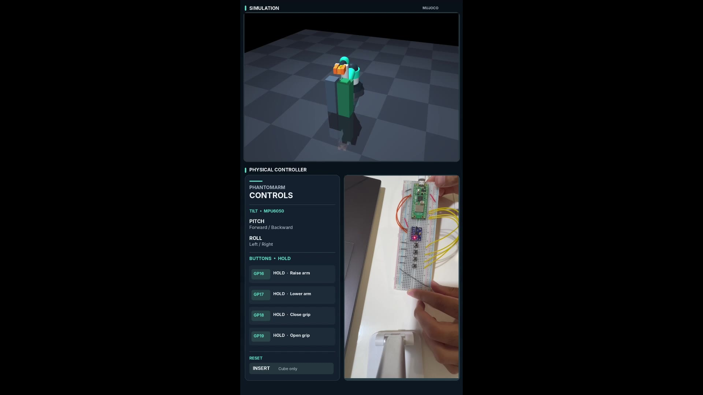
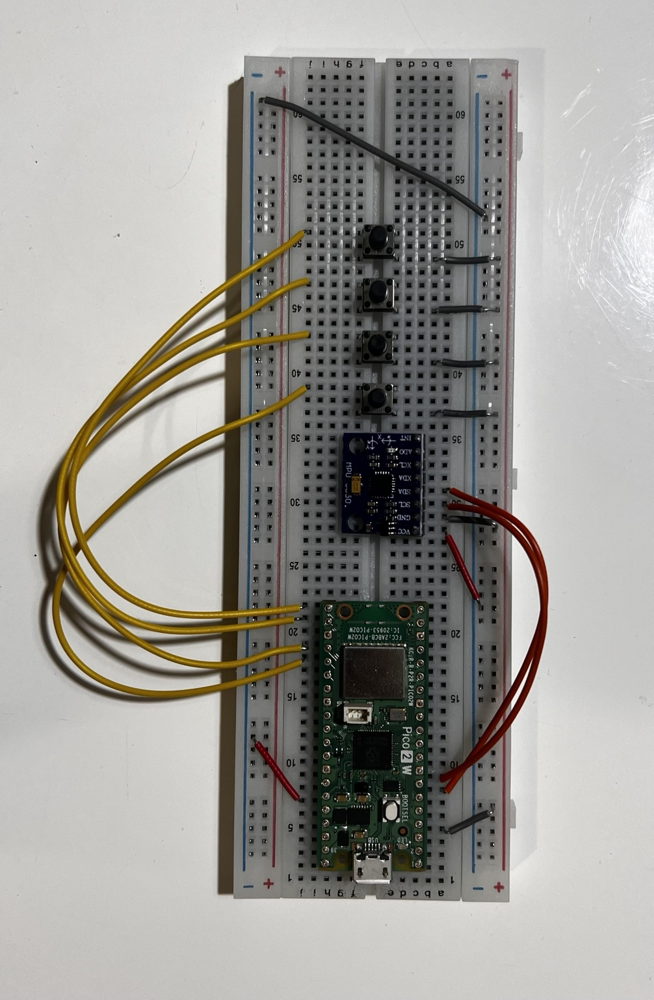

# PhantomArm | IMU-Controlled Robotic Arm Teleoperation



**Pico 2 W + MPU6050 + physical buttons → USB serial → Python controller → MuJoCo robot arm**

A hands-on robotics and embedded-systems project that uses a physical motion controller to operate an original four-joint simulated robotic arm with a two-finger gripper. The arm can pick up a movable cube, lift it, transport it between platforms, and release it using real MuJoCo contact physics—without attaching the cube artificially to the gripper.

**Project status:** Hardware controller and simulation demonstrated working together in repeated user-operated pick-and-place trials (November 2026). The reset, grasping behavior and controls were iteratively debugged. This is a teleoperation prototype, **not** a certified safety-critical robotic system.

## Demonstration

[**Watch the full physical-controller demonstration (MP4)**](media/phantomarm_hardware_demo.mp4)

[](media/phantomarm_hardware_demo.mp4)

### Physical controller



## Hardware configuration

| Component | Pico 2 W GPIO | Physical pin | Purpose |
|---|---|---|---|
| MPU6050 SDA | GP4 | 6 | I²C data |
| MPU6050 SCL | GP5 | 7 | I²C clock |
| MPU6050 VCC | 3V3(OUT) | 36 | 3.3 V sensor power |
| MPU6050 GND | GND | 38 | Common ground |
| Button 1 | GP16 | 21 | **Hold** to raise arm (Z+) |
| Button 2 | GP17 | 22 | **Hold** to lower arm (Z−) |
| Button 3 | GP18 | 24 | **Hold** to close gripper |
| Button 4 | GP19 | 25 | **Hold** to open gripper |

Each button is wired between its GPIO pin and GND, configured as `INPUT_PULLUP`. The firmware uses button debouncing and excludes contradictory simultaneous direction/grip commands. Sensor tilt controls X and Y, while the four buttons handle Z and grip.

**Physical controller:** tilt MPU6050 → X/Y; **hold** GP16 / GP17 → raise / lower; **hold** GP18 / GP19 → close / open. Releasing a grip button maintains the current commanded opening.

**Keyboard fallback:** arrow keys jog Z/Y; `7`/`8` jog X; hold `6` to close and `Enter` to open the gripper. `Insert` resets **only** the cube (do **not** use Backspace/Delete); `F11` recalibrates the IMU; `9` enables simulated emergency stop and `Space` releases it. `Home` parks and `End` resumes.

## System architecture

```text
  [MPU6050] -- I²C --> [Raspberry Pi Pico 2 W] <-- four buttons
                               |
                   Arduino C++ (PA2 @ 115200 baud)
                               |
                         USB serial / COM port
                               |
             [Python serial parser + calibration/filter]
                               |
               [Target pose + workspace / IK guards]
                               |
                   [Analytic inverse kinematics]
                               |
               [MuJoCo arm + physical contact grasp]
```

The controller takes its **first valid sample as neutral**; the MPU6050 reports orientation relative to its pose on startup. Hardware is a *tilt-based control device*, not a full six-degree-of-freedom position tracker. The Python input pipeline validates telemetry and applies smoothing and stale-input handling.

### Serial protocol

The physical four-button controller uses:

```text
PA2,milliseconds,sequence,roll_deg,pitch_deg,z_up,z_down,grip_close,grip_open,valid
```

For example: `PA2,25059,474,-0.14,11.78,0,0,1,0,1`. Button values are binary; the software also supports the earlier `PA1` telemetry and demo/replay sources. The Arduino source **actually used for the hardware demo** is [`sketch/sketch.ino`](sketch/sketch.ino). The older [`firmware/PhantomArm_Pico2W/PhantomArm_Pico2W.ino`](firmware/PhantomArm_Pico2W/PhantomArm_Pico2W.ino) is retained as historical source and does **not** implement the final four-button PA2 setup.

## Run on Windows

Requirements: Python with project dependencies installed, MuJoCo-compatible graphics environment, Arduino IDE with the Pico 2 W board support, and the connected Pico on a USB serial COM port.

From this repository's root directory:

```powershell
# One-time environment setup (if required)
.\scripts\setup_windows.bat

# Find your hardware COM port (for example COM3)
.\.venv\Scripts\python.exe -m serial.tools.list_ports -v

# Launch with a real controller
.\.venv\Scripts\python.exe -m phantomarm.app --mode serial --port COM3 --scene grasp

# Simulation-only mode (no controller needed)
.\scripts\run_grasp_demo.bat
```

Close Arduino Serial Monitor before opening COM3 in Python. Replace `COM3` with the detected port. Hold the sensor steady for startup calibration. If `.\.venv\Scripts\python.exe` is missing, create/install the virtual environment first using the supplied setup script.

## Testing and implementation

- Six MuJoCo position actuators: four arm joints and two gripper slides.
- Custom analytic IK, motion slew limiting and Cartesian workspace safeguards.
- Contact-based cube grasp, with pickup/drop pedestals and cube-only reset.
- Serial framing, validity/sequence checks, calibration, filtering, input timeout and emergency-state logic.
- Python regression tests in [`tests/`](tests/) and a scripted headless grasp diagnostic.

```powershell
.\scripts\test_all.bat
.\scripts\run_grasp_diagnostic.bat
```

**Validation note:** The creator confirmed physical pick-and-place and repeat operations in the supplied video. Tests should be rerun on each cloned machine before asserting a new test-pass count. An occasional off-angle cube wedge may still require operator recovery or cube-only reset.

## Repository layout

- `phantomarm/` — Python controller, telemetry, safety limits and MuJoCo application
- `sketch/sketch.ino` — **final PA2** Pico 2 W Arduino C++ firmware
- `assets/` — original editable MJCF model including the physical grasp scene
- `scripts/` — Windows launch/setup and test commands
- `tests/` — regression and physical-model validation tests
- `media/` — animated README banner, real hardware photo and demonstration video, social preview, and a clearly labeled industrial concept illustration
- `docs/` — detailed technical notes, including older iteration notes (some shortcuts in historical files are superseded by this README)
- `recordings/` — example telemetry replay

## Technology

**Arduino C++**, **Raspberry Pi Pico 2 W (RP2350)**, **MPU6050**, **I²C**, **USB serial**, **Python**, **pySerial**, **MuJoCo**, analytic **inverse kinematics**, input filtering and simple fail-safe state management.

## License

MIT — see [LICENSE](LICENSE). This repository includes original project code and demo media. The project is intended for research, learning and portfolio demonstration.
