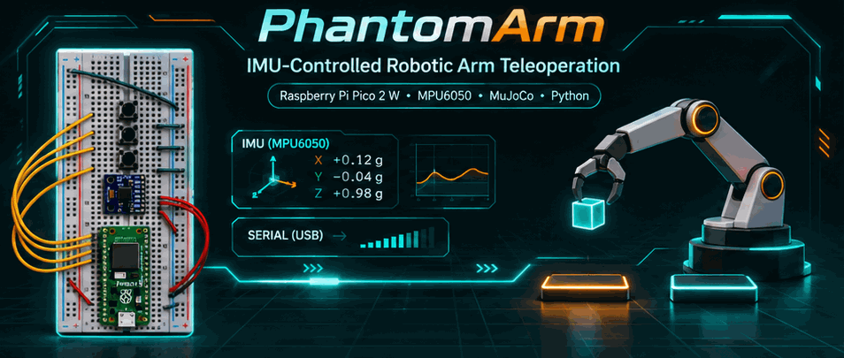
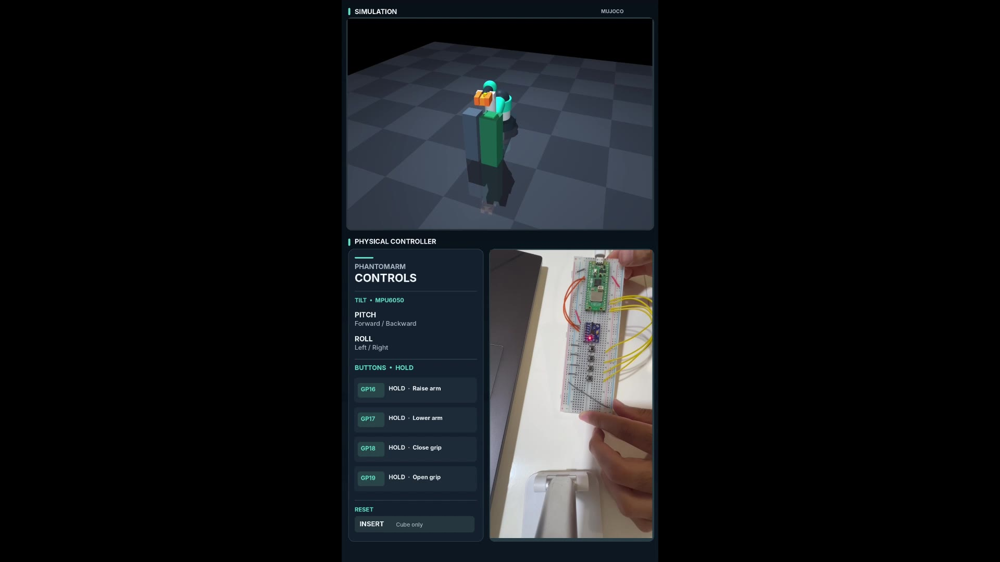
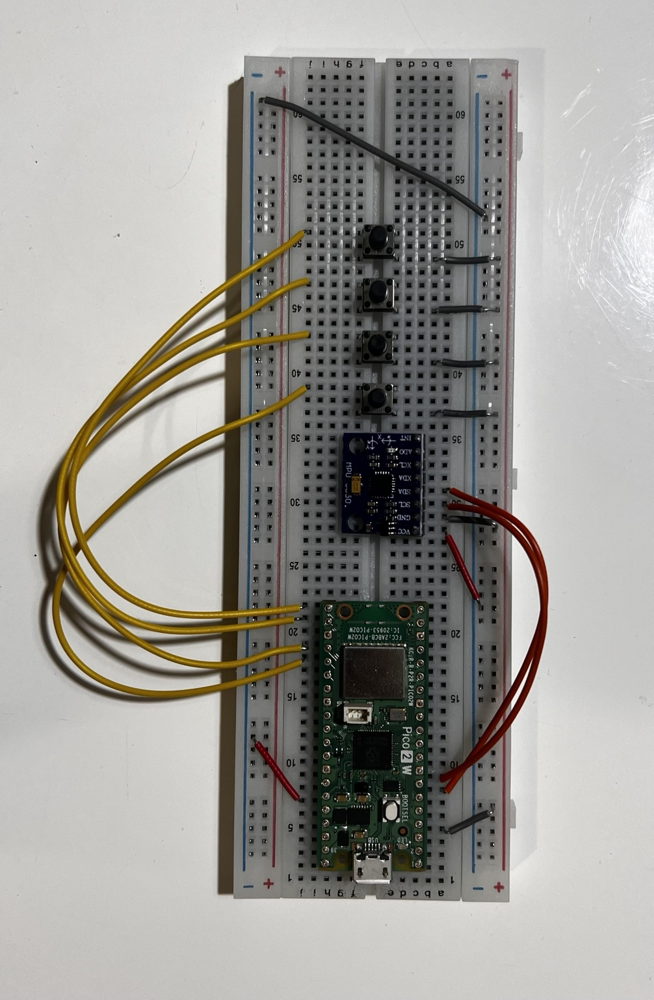
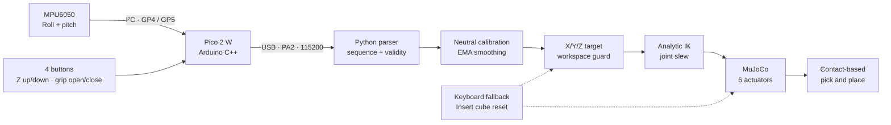

<p align="center">
  
</p>

# PhantomArm

**IMU-Controlled Robotic Arm Teleoperation · Physical Controller + MuJoCo Simulation**

`Raspberry Pi Pico 2 W` · `MPU6050` · `Arduino C++` · `USB Serial` · `Python` · `MuJoCo`

*Build a physical motion controller, move a simulated robot in real time, and perform genuine contact-based pick-and-place.*

**v1.0.0 · Windows-first · 4-DOF arm + 2-finger gripper · PA2 hardware controller**

---

## See it working

[](media/phantomarm_hardware_demo.mp4)

**▶ [Watch the real-time hardware-controlled demonstration (MP4)](media/phantomarm_hardware_demo.mp4)** — two simultaneous views: the **MuJoCo robot** and the **physical Pico 2 W + MPU6050 controller**. The operator approaches, grasps, lifts, transports, releases, and resets the cube. **The physical hardware controls a simulated arm; no physical industrial arm is claimed.**

<table>
<tr><th>Physical controller used in the demo</th><th>What the project demonstrates</th></tr>
<tr>
<td width="45%"></td>
<td valign="top"><ul>
<li><strong>Human-in-the-loop teleoperation:</strong> tilt the MPU6050 for X/Y positioning.</li>
<li><strong>Four tactile buttons:</strong> hold to raise, lower, close or open the gripper.</li>
<li><strong>Embedded-to-PC communication:</strong> structured PA2 messages over USB serial.</li>
<li><strong>Robotics math:</strong> calibrated, filtered target poses; analytic inverse kinematics; slew limiting.</li>
<li><strong>Physics-based manipulation:</strong> friction/contact-driven gripping with a free-moving cube.</li>
<li><strong>Recoverability:</strong> cube-only reset without resetting the arm or its controller.</li>
</ul></td>
</tr>
</table>

> **Scope:** This is a working **physical-controller → simulated-robot** prototype. The industrial concept image included in the media folder illustrates possible future applications; it is not a photograph of an installed industrial system.

## On this page

[Quick start](#quick-start-windows) · [Architecture](#system-architecture) · [Hardware and wiring](#hardware-and-wiring) · [Full control map](#control-map) · [Serial protocol](#pa2-serial-telemetry) · [Engineering design](#engineering-design) · [Simulation and grasp](#mujoco-robot-and-grasp-physics) · [Validation](#tests-and-validation) · [Troubleshooting](#troubleshooting)

## Project at a glance

| Area | Implementation |
|:--|:--|
| **Manipulator** | Original 4-revolute-joint arm: base yaw, shoulder pitch, elbow pitch, wrist pitch; 2 independently actuated finger slides |
| **Physical interface** | Raspberry Pi Pico 2 W (RP2350), MPU6050 IMU, four momentary pushbuttons |
| **Movement** | Sensor tilt → X/Y target; held buttons → continuous Z and gripper adjustments |
| **Transport** | I²C from MPU6050 to Pico; PA2 text telemetry over USB serial at **115200 baud** |
| **Host control** | Python calibration, exponential smoothing, workspace constraints, analytic IK and motion slew |
| **Simulation** | MuJoCo with six position actuators, rigid-body contacts, frictional grasp and movable cube |
| **Completed demo** | Hardware-controlled pickup → lift → sideways transfer → release → cube-only reset |
| **Operating system** | Windows for the tested GUI/hotkey workflow; core mathematics can run independently |

## Quick start (Windows)

### 1. Install the software

- **Python 3.11** is targeted by the included setup batch file (`py -3.11`).
- The project pins **MuJoCo 3.14.0** and uses `numpy`, `pyserial` and `pytest` (see `requirements.txt`).
- For hardware, install Arduino IDE and the **Raspberry Pi Pico/RP2040/RP2350** board package; select **Raspberry Pi Pico 2 W**.
- Flash the **final four-button PA2 firmware** from `sketch/sketch.ino` (not the older prototype under `firmware/`).

Open **PowerShell inside the repository root** (where `README.md` and `scripts/` are visible):

```powershell
# One-time Python environment setup
.\scripts\setup_windows.bat

# Verify available serial ports (close Arduino Serial Monitor first)
.\.venv\Scripts\python.exe -m serial.tools.list_ports -v
```

### 2. Run the hardware-controlled robot

```powershell
# Replace COM3 with the port listed on YOUR computer
.\.venv\Scripts\python.exe -m phantomarm.app --mode serial --port COM3 --scene grasp
```

Keep the MPU6050 steady for the initial calibration. Click the MuJoCo viewer to use keyboard fallback controls. The four breadboard buttons work through the serial connection.

**No Pico connected?** Use simulation-only mode:

```powershell
.\scripts\run_grasp_demo.bat
```

**Want to inspect the physics without using the GUI?**

```powershell
.\scripts\test_all.bat
.\scripts\run_grasp_diagnostic.bat
```

## System architecture



**End-to-end sequence:** (1) the MPU6050 produces gravity-based tilt readings; (2) the Pico reads them and four buttons; (3) Python validates PA2 packets and captures a neutral pose; (4) filtered roll/pitch become Cartesian targets; (5) analytic IK finds a joint configuration; (6) rate-limited actuator commands drive the MuJoCo arm; (7) contact forces—not a scripted attachment—determine whether the cube is held.

## Hardware and wiring

The complete build needs **one Pico 2 W, one MPU6050 breakout, four normally-open four-legged tactile switches, one breadboard, jumper wires and a USB data cable**. For the four-legged switches, use one terminal from **each of the two separate contact pairs**: terminals on the same internally connected side are not a working switch connection.

| Signal / component | Pico GPIO | Physical Pico pin | Connection / behavior |
|:--|:--:|:--:|:--|
| MPU6050 **VCC** | 3V3(OUT) | **36** | Supply sensor breakout from 3.3 V; check module voltage compatibility |
| MPU6050 **GND** | GND | **38** | Common ground |
| MPU6050 **SDA** | GP4 | **6** | I²C data |
| MPU6050 **SCL** | GP5 | **7** | I²C clock |
| **Z Up** switch | GP16 | **21** | Switch between GPIO and GND; **hold** to raise |
| **Z Down** switch | GP17 | **22** | Switch between GPIO and GND; **hold** to lower |
| **Grip Close** switch | GP18 | **24** | Switch between GPIO and GND; **hold** to close |
| **Grip Open** switch | GP19 | **25** | Switch between GPIO and GND; **hold** to open |

**Firmware wiring settings:** `Wire.setSDA(4)`, `Wire.setSCL(5)`, `Wire.setClock(100000)` (**100 kHz I²C**). The sensor is at **I²C address `0x68`** in the demonstrated build. Buttons use `INPUT_PULLUP`: **LOW = pressed**, **HIGH = released**; no extra external pull-up is required for this configuration. The code debounces inputs for **25 ms**.

**Safety when wiring:** disconnect USB power, verify the 3.3 V and ground connections, and ensure that a button never directly shorts 3.3 V to ground. All four button ground connections may share the same rail.

## Control map

### Physical controller (used in the demo)

| Input | Action | Behavior when released |
|:--|:--|:--|
| Tilt MPU6050 **forward / backward** | X-axis target movement | Target follows measured tilt relative to startup neutral |
| Tilt MPU6050 **left / right** | Y-axis target movement | Target follows measured tilt relative to startup neutral |
| **Hold GP16** | Raise arm, **Z+** | Stop changing height |
| **Hold GP17** | Lower arm, **Z−** | Stop changing height |
| **Hold GP18** | Gradually **close** gripper | Retain current commanded finger position |
| **Hold GP19** | Gradually **open** gripper | Retain current commanded finger position |

When both height buttons are held, neither direction is sent. When both gripper buttons are held, neither gripper direction is sent. Releasing both fingers does **not** make the cube magically stick: real MuJoCo contact and friction must maintain the hold.

### Keyboard fallback and maintenance

| Key | Action |
|:--|:--|
| **↑ / ↓** | Raise / lower the robot end-effector target |
| **← / →** | Move sideways (Y+ / Y−) |
| **7 / 8** | Forward / backward (X+ / X−) |
| **Hold 6** | Close the gripper gradually |
| **Hold Enter** | Open the gripper gradually |
| **Insert** | **Cube-only respawn**; does not home or reset the arm (Windows) |
| **Type `cube` + Enter in running terminal** | Backup cube-only respawn |
| **F11** | Re-zero current IMU orientation |
| **9** | Simulation emergency stop |
| **Space** | Release emergency stop / begin recalibration |
| **Home / End** | Park arm / resume live control |
| **F12** | Quit simulation |

**Do not use Delete or Backspace for cube reset.** Those keys conflicted with MuJoCo's own viewer behavior in earlier iterations. The confirmed operational shortcut is **Insert**.

## PA2 serial telemetry

### Message layout

The final Arduino firmware emits a CSV-like ASCII message every **50 ms (~20 Hz)**:

```text
PA2,milliseconds,sequence,roll_deg,pitch_deg,z_up,z_down,grip_close,grip_open,valid
```

Illustrative PA2 frame:

```text
PA2,25059,474,-0.14,11.78,0,0,1,0,1
```

| Field | Meaning |
|:--|:--|
| `PA2` | Protocol version for the four-button controller |
| `milliseconds` | Pico uptime in milliseconds (`millis()`) |
| `sequence` | Increasing frame counter; repeated / older frames are rejected |
| `roll_deg`, `pitch_deg` | Accelerometer-derived tilt in degrees (not absolute spatial position) |
| `z_up`, `z_down` | Independent continuous-height requests (`0` or `1`) |
| `grip_close`, `grip_open` | Independent continuous finger-control requests (`0` or `1`) |
| `valid` | Whether the sensor read succeeded (`1`) or failed (`0`) |

The host checks field count, numeric values, finite angles, binary flags and ordered sequence numbers; invalid frames are not used for motion. The earlier **PA1** format is still supported for compatibility with demos/replays, but **PA2** is required for the four physical buttons. The current firmware does **not** command gripper state by physically positioning the user's hand—it uses the two gripper buttons.

## Engineering design

The essentials are below so you can understand the **design decisions and real implementation values directly on this page**, without reading the detailed mathematics.

### Sensor processing and motion mapping

1. The **MPU6050** measures acceleration; the firmware estimates **roll and pitch** from gravity (±2g configuration, **16,384 counts/g**).
2. At startup, Python captures the first valid angles as the **neutral position**. A resting pitch offset (for example, +11.6°) therefore does not command movement.
3. Tilt is limited to **±35°** and smoothed using an **exponential moving average (EMA), α = 0.25**.
4. Filtered **pitch controls X** and **roll controls Y**, while held buttons independently adjust Z and the gripper.
5. The requested position is checked against the robot's **workspace, pedestal clearance, and inverse-kinematics reachability** before joint commands are applied.

| Engineering setting | Value in the implementation | Why it matters |
|:--|:--|:--|
| Tilt input limits | **−35° to +35°** per axis | Restrains unintended large movements |
| Neutral calibration | **First valid frame; F11 to recalibrate** | Corrects for the way the controller is held |
| Sensor smoothing | **EMA α = 0.25** | Reduces visible jitter |
| X target range | **0.27–0.49 m** | Limits forward/backward movement |
| Y target range | **−0.17–+0.17 m** | Limits side-to-side movement |
| X sensitivity (before clamps) | **≈3.14 mm per degree of pitch** | Sets response to forward/backward tilt |
| Y sensitivity (before clamps) | **≈4.86 mm per degree of roll** | Sets response to sideways tilt |
| PA2 telemetry | **20 Hz**, **115200 baud** | Sends the IMU and button states to Python |

**Readable mapping (with keyboard offsets `dx`, `dy`):**

```text
X target (m) = clamp(0.38 - 0.11 * filtered_pitch / 35 + dx, 0.27, 0.49)
Y target (m) = clamp(0.17 * filtered_roll  / 35 + dy, -0.17, 0.17)
```

### Arm motion and inverse kinematics

PhantomArm uses **four rotary joints** (base yaw, shoulder, elbow, wrist pitch) plus **two independently actuated finger slides**. An analytic two-link inverse-kinematics solver converts the desired `(X, Y, Z)` tool position into joint targets; a slew limiter prevents abrupt changes. Joint limits and unreachable targets are checked before applying commands.

| Arm parameter | Value |
|:--|--:|
| Shoulder reference height | **0.22 m** |
| Upper-arm segment | **0.30 m** |
| Forearm segment | **0.26 m** |
| Wrist/tool offset | **0.10 m** |
| Grasp-scene initial hover target | **(0.38, 0.00, 0.43) m** |
| Initial computed joint targets (yaw / shoulder / elbow / wrist) | **(0.000, 0.166, −1.798, 1.632) rad** |

### Z motion, gripper and protection

| Control / safety feature | Implemented behavior |
|:--|:--|
| **Hold Z Up / Down** | Requested height changes at **35 mm/s**, constrained to **0.30–0.52 m** and additional pedestal keep-out rules |
| **Hold Grip Close** | Finger targets close at **14 mm/s** (0–25 mm per finger) |
| **Hold Grip Open** | Finger targets open at **9 mm/s** (0–25 mm per finger) |
| **READY** | Valid, fresh sensor data permits tracking |
| **HOLD** | Stale/invalid data holds the last joint command; this simulation pauses its physics update |
| **ESTOP** | Software stop latched until released; **not** a certified physical E-stop |
| **Telemetry timeout** | **0.40 s** without fresh valid data triggers HOLD |
| **Conflicting button presses** | Opposing Z or gripper commands cancel |
| **Cube-only reset** | Changes only the cube's free-joint position/velocity after a spawn obstruction check; arm/controller state is preserved |

The commanded rates describe **control targets**, not guaranteed physical motion under load. Frictional grasp success still depends on the MuJoCo contact solver, geometry, and cube orientation.

<details>
<summary><strong>Optional: full mathematical derivations and worked IK example</strong></summary>

The detailed formulas, assumptions, joint-limit checks, and worked hover-pose example are preserved in [Engineering Calculations](docs/ENGINEERING_CALCULATIONS.md). The main README intentionally keeps the implementation summary visible without requiring readers to open a separate file.

</details>

## MuJoCo robot and grasp physics

The robot and grasp challenge are defined in a readable **MJCF XML** model, `assets/phantom_arm_grasp.xml`.

| Simulated property | Model value |
|:--|:--|
| Arm joint actuators | **4** position actuators |
| Gripper actuators | **2** slide-position actuators (one per finger) |
| Cube | **46 × 46 × 46 mm**, **10 g** (`0.010 kg`) |
| Cube spawn center | **(0.43, 0.00, 0.350) m** |
| Pickup pedestal center | **(0.43, 0.00) m** in XY |
| Drop pedestal center | **(0.43, 0.12) m** in XY — **12 cm** sideways |
| Both pedestal tops | **Z = 0.327 m** |
| Initial grasp-scene tool hover target | **(0.38, 0.00, 0.43) m** |
| Gripper pad friction / cube friction | Sliding-friction coefficients **8.0 / 5.0** in their respective MJCF contact settings |
| MuJoCo integrator | `implicitfast`, timestep **0.003 s**, `iterations=100`, `noslip_iterations=5` |
| Cube physics | **Free joint**: 7 position coordinates (XYZ + quaternion) and 6 velocities |

Each position actuator uses stiffness/damping (`kp` / `kv`) instead of instant joint teleportation:

| Actuator | `kp` | `kv` |
|:--|--:|--:|
| Yaw | 170 | 22 |
| Shoulder | 200 | 24 |
| Elbow | 160 | 18 |
| Wrist | 70 | 10 |
| Left / right finger (each) | 1500 | 45 |

**How grasping works:** Fingers close gradually around a dynamic rigid-body cube. The simulator resolves contact between both finger pads and the cube. The cube is lifted or dropped as a consequence of simulated forces and friction; the code does **not** teleport, weld, or artificially attach it to the fingers. The goal marker represents the desired target, not a guaranteed measured tip position.

**Cube-only reset:** Press **Insert** or type `cube` in the running terminal. Before respawning, the application checks whether the robot occupies the cube's starting volume. If clear, only the cube free joint's **7 position coordinates and 6 velocity coordinates** are restored; the arm's joint state, actuator commands, gripper target and controller target remain in place. If the spawn is obstructed, reset is rejected—move the arm aside and retry.

## Tests and validation

### How to reproduce

```powershell
# Python unit tests + compiled-MJCF / IK-FK verification
.\scripts\test_all.bat

# Three complete headless physics trials of the contact-based grasp
.\scripts\run_grasp_diagnostic.bat
```

### Reported and independently checked outcomes

| Evidence | Result | What it supports |
|:--|:--|:--|
| **Automated tests in this review environment** | **76 passed, 9 skipped** | Python/structural tests passed; MuJoCo-dependent tests skipped because MuJoCo was not installed here |
| **Windows MuJoCo physics diagnostic** | **3/3 full trials previously reported passing** | Earlier validated runs reported successful grasp, hold, transport, release and reset; **not rerun in this review environment** |
| **Real controller demonstration** | **Completed by project creator; video included above** | User-operated X/Y tilt, button-driven Z/grip, cube transfer and reset |
| **Static model check specification** | **4 IK/FK target poses; error < 0.1 mm** | Expected analytical-model consistency criterion; run on a MuJoCo-enabled machine to reproduce |

### What the three-trial physics diagnostic checks

| Stage | Pass criterion |
|:--|:--|
| **1. Stable startup** | Cube remains on original platform during **≥3 s** hover; test checks vertical settling ≤ **8 mm** |
| **2. Physical grip** | Both left and right finger pads contact the free cube (**2 distinct finger contacts**) |
| **3. Lift** | Cube rises at least **30 mm** above original position, retaining both pad contacts; previously reported runs reached ~**58 mm** |
| **4. Hold** | Maintain two-pad grip for **≥3 s** |
| **5. Transport** | Move from pickup toward target at **Y = 0.12 m**, maintaining contact |
| **6. Release** | Cube contacts destination pedestal after fingers open and arm retracts |
| **7. Reset guard** | Block cube respawn if robot obstructs the original volume |
| **8. Cube-only reset** | Restore cube position/velocity while preserving all six robot joint positions, velocities and actuator controls; repeat sequence **3 times** |

The local automated tests also cover telemetry parsing and invalid inputs, neutral capture, smoothing, timeout handling, joint-limit reachability, keyboard jogging, button ramping, collision flags, reset invariance and scene structure. **A passing unit suite alone is not presented as proof of physical grasping**—the contact-physics diagnostic and the actual hardware video serve that separate purpose.

## Troubleshooting

| Symptom | What to check |
|:--|:--|
| `\.venv\Scripts\python.exe` not found | You are likely outside the project root or haven't run `scripts\setup_windows.bat`. Check the VS Code terminal working directory. |
| `COM3` unavailable or permission error | Arduino Serial Monitor/miniterm may still be holding the port. Close it; list ports and use the correct COM number. |
| Arm does not move in serial mode | Verify PA2 lines, `valid=1`, increasing sequence numbers, board calibration and that the app was started with `--mode serial --port COMx --scene grasp`. |
| Buttons do not respond | Use **GP16/17/18/19** to GND, not 3.3 V; check opposite sides of each four-pin switch and `INPUT_PULLUP` behavior. |
| Arm moves unexpectedly after startup | Hold the sensor steady and press **F11** to recalibrate the neutral orientation. |
| Cube will not reset | Use **Insert**, not Delete/Backspace. Clear the pickup spawn position first; `cube` + Enter in the simulation terminal is the fallback. |
| Cube is wedged at a corner | Hold **open gripper**, retract or raise gently, then use cube-only reset after clearing the spawn; imperfect off-angle grasps are a known limitation. |
| Cannot descend onto pedestal | A conservative **0.35 m** tool-height keep-out is intentionally active near both platforms. |
| Script says test failed | Run both the unit suite and headless physics diagnostic; check the full output rather than relying on historical pass counts. |

## Repository structure

```text
PhantomArm/
├── README.md                     # THIS complete overview
├── .gitignore / LICENSE / requirements.txt
├── phantomarm/                   # Parser, controller, IK, safety, grasp, application
├── sketch/sketch.ino             # FINAL four-button PA2 firmware
├── assets/                       # Standard and grasp-scene MJCF models
├── scripts/                      # Windows setup, demos, tests, physics diagnostic
├── tests/                        # Unit and MuJoCo-dependent regression tests
├── media/                        # Animated banner, hardware photo, real demo, preview
├── recordings/                   # Example telemetry for replay
├── tools/                        # Session log plotting
├── firmware/                     # Historical first-generation firmware (not PA2)
└── docs/                         # Optional background and iteration history
```

Everything needed to **understand, build, operate, calculate, and validate** the current system is described **on this page**. Other project files are provided for reproducibility and source inspection—not as required reading to understand the project.

## Limitations & future directions

- **Virtual manipulator, physical controller:** no fabricated industrial arm or real motor load is connected.
- **Accelerometer tilt rather than full 3D tracking:** the controller estimates orientation under gravity; translational acceleration and fast motion may disturb readings.
- **No production safety certification:** software stop, simple pedestal keep-out and contact simulation are not industrial safety systems.
- **Corner grasps:** off-center cube orientations can wedge between high-friction pads and the wrist; cube-only recovery is available.
- **Next engineering extensions:** filtered gyro-assisted attitude estimation, improved grasp geometry, measured response latency, physical closed-loop actuator integration and more complex manipulation tasks.

## References & license

Engineering values, wiring, and test criteria above are taken from the **checked-in project source**. Optional [mathematical derivations and worked examples](docs/ENGINEERING_CALCULATIONS.md) are kept separate from third-party references and licensing. Useful upstream documentation:

- [Raspberry Pi — Pico 2 / Pico 2 W documentation](https://www.raspberrypi.com/documentation/microcontrollers/pico-series.html)
- [Arduino-Pico — I²C (`Wire`) reference](https://arduino-pico.readthedocs.io/en/latest/wire.html)
- [TDK InvenSense — MPU-6000/6050 register map](https://invensense.tdk.com/wp-content/uploads/2015/02/MPU-6000-Register-Map.pdf)
- [MuJoCo documentation](https://mujoco.readthedocs.io/en/stable/)
- [pySerial documentation](https://pyserial.readthedocs.io/en/latest/)

**License:** [MIT](LICENSE). Images of potential industrial applications are **concept illustrations**, not evidence of production deployment.
